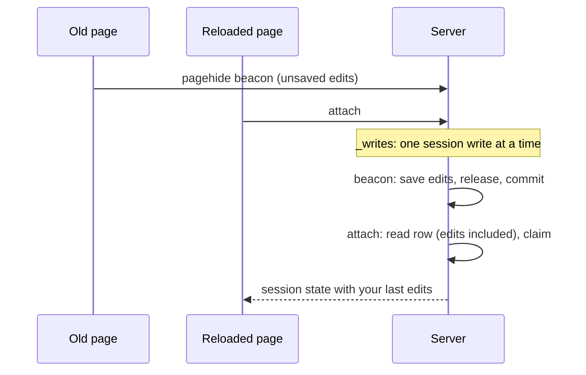

# Session storage

How a session is stored, cut from [session.md](../system/session.md).

## How it is stored

One row per session in SQLite (`sessions`), alongside connections and workspaces
— see [connect.md](./storage.md#storage--migrations).

```sql
id              TEXT PRIMARY KEY  -- also the agent channel id
seq             INTEGER           -- stable ordinal behind "Session 3"
label           TEXT              -- NULL = Session <n>; set = pinned by you
connection_name TEXT              -- NULL is the durable "disconnected" state
connection_by   TEXT              -- "agent" | "user": who switched it (agent → toast)
database        TEXT
workspace       TEXT
url             TEXT              -- path + query string
ui              TEXT              -- JSON, namespaced by view
last_visited    TEXT              -- JSON {connection: {database, table}}
claimed_by      TEXT              -- the tab token holding it
claim_seen_at   INTEGER           -- unix ms; stale after 90s
last_active_at  INTEGER           -- unix ms
tab             TEXT              -- set on an agent's tab: what it opened it for
```

`ui` is a blob rather than columns for the same reason a connection's config is:
a view can remember a new setting without a migration.

```json
{"query": {"sql": "…", "limit": 100, "visibleCols": [], "orderBy": []},
 "scripts": {"sql": "…"},
 "explorer": {"sidebarWidth": 256}}
```

Every `/api/*` request names its session with an `X-QV-Session` header. There is
no session cookie — a session is named by its id, not by the browser it is open
in, which is what lets two tabs sit on two different databases. The one
exception is the remote-control SSE stream, which takes `?session=` because
`EventSource` cannot send headers.

**Nothing is written while you are still typing.** Leaving the query panel is
what "done editing" means, so that is when its state is written — the same
focus-out signal the [edit lock](../system/mcp.md) uses, so both agree on when you
have finished. Discrete acts (a navigation, a workspace switch, a rename) write
at once.

Everything else rides two backstops: `pagehide` beacons whatever is still
pending, covering a reload, a close or a navigation away, and a 5s idle timer,
so a tab that dies mid-edit loses at most what was typed since its last pause.
The explorer's sidebar width has no focus to leave, so it is written by those
alone.

Writes are fire-and-forget — the page never waits on one, and a lost patch costs
a remembered preference, never your work in the live tab.

**A reload keeps what you typed just before it.** A reload sends the server two
requests for the same session, milliseconds apart: the old page's `pagehide`
beacon with its unsaved edits, then the new page's `attach`, which reads the
session back. If `attach` read the row before the beacon's write was committed,
the page would come back without those last edits. Session writes therefore run
one at a time (the `_writes` lock in `sessions.py`), so `attach` waits for the
beacon:



The `/api/sessions/*` shapes are in [api.md](../system/api.md). Connection and database
are not among them — `/api/db/connect`, `/open` and `/database` write those
through, so connection changes keep one path.

## Related docs

- [session.md](../system/session.md) — sessions: what a tab remembers, refresh and the claim.
- [storage.md](./storage.md) — the SQLite data directory and migrations.
- [mcp.md](./mcp.md) — the MCP tools and channels.
- [api.md](./api.md) — backend JSON API.
