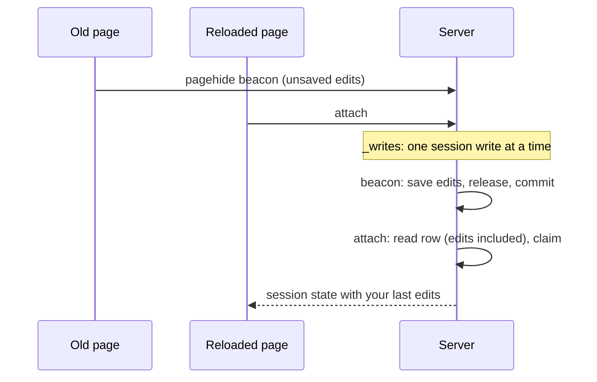

# Session storage

How a session is stored and how a tab claims one. What a session is to a user is in [session.md](../system/session.md).

## How it is stored

One row per session in SQLite (`sessions`), alongside connections and workspaces
— see [storage.md](./storage.md#storage--migrations).

```sql
id              TEXT PRIMARY KEY  -- also the agent channel id
seq             INTEGER           -- stable ordinal behind "Session 3"
label           TEXT              -- NULL = Session <n>; set = pinned by you
connection_name TEXT              -- NULL is the durable "disconnected" state
connection_by   TEXT              -- "agent" | "user": who switched it (agent → toast)
database        TEXT
workspace       TEXT
url             TEXT              -- path + query string
ui              TEXT              -- JSON, namespaced by view
last_visited    TEXT              -- JSON {connection: {database, table}}
claimed_by      TEXT              -- the tab token holding it
claim_seen_at   INTEGER           -- unix ms; stale after 90s
last_active_at  INTEGER           -- unix ms
tab             TEXT              -- set on an agent's tab: what it opened it for
```

`ui` is a blob rather than columns for the same reason a connection's config is:
a view can remember a new setting without a migration.

```json
{"query": {"sql": "…", "limit": 100, "visibleCols": [], "orderBy": []},
 "scripts": {"sql": "…"},
 "explorer": {"sidebarWidth": 256}}
```

Every `/api/*` request names its session with an `X-QV-Session` header. There is
no session cookie — a session is named by its id, not by the browser it is open
in, which is what lets two tabs sit on two different databases. The one
exception is the remote-control SSE stream, which takes `?session=` because
`EventSource` cannot send headers.

Only the live driver state — the decrypted config and the database list — is
held in memory, as a cache. A backend restart costs one reconnect, not the
session.

**Nothing is written while you are still typing.** Leaving the query panel is
what "done editing" means, so that is when its state is written — the same
focus-out signal the [edit lock](../system/mcp.md) uses, so both agree on when you
have finished. Discrete acts (a navigation, a workspace switch, a rename) write
at once.

Everything else rides two backstops: `pagehide` beacons whatever is still
pending, covering a reload, a close or a navigation away, and a 5s idle timer,
so a tab that dies mid-edit loses at most what was typed since its last pause.
The explorer's sidebar width has no focus to leave, so it is written by those
alone.

Writes are fire-and-forget — the page never waits on one, and a lost patch costs
a remembered preference, never your work in the live tab.

**A reload keeps what you typed just before it.** A reload sends the server two
requests for the same session, milliseconds apart: the old page's `pagehide`
beacon with its unsaved edits, then the new page's `attach`, which reads the
session back. If `attach` read the row before the beacon's write was committed,
the page would come back without those last edits. Session writes therefore run
one at a time (the `_writes` lock in `sessions.py`), so `attach` waits for the
beacon:



The `/api/sessions/*` shapes are in [api.md](./api.md). Connection and database
are not among them — `/api/db/connect`, `/open` and `/database` write those
through, so connection changes keep one path.

## Claims and the heartbeat

What a user sees of this is in
[session.md](../system/session.md#refresh-new-tabs-and-the-claim).

Each tab keeps `qv_tab` (a token it mints) and `qv_session` (what it is attached
to) in `sessionStorage`. Both survive a refresh, neither crosses to a new tab —
so **a tab that already has an id is refreshing, a tab without one is new.**

Tabs re-attach every 10 seconds, which doubles as the heartbeat, and beacon a
release when they close. The 90-second hold is well past a minute because
browsers throttle a hidden tab's timers to about one run a minute.

`POST /api/sessions/attach` decides in one server-side pass, so two tabs opening
at once cannot race: the id the tab already has if it is free or already this
tab's, else the most recently active unheld session, else a new one. The first
case falls through when a *different* live tab holds that id — duplicating a tab
copies its `sessionStorage`, and the copy must not hijack the original.

The 90 seconds before an unnamed session is swept are the reload grace: a
reload's release beacon can land after its re-attach, and the next heartbeat
re-claims the session well within it.

A tab whose claim lapsed learns it on its next heartbeat (sent with `keep`, see
[api.md](./api.md)), which gets a `409`.

The row is also the truth for the connection and its database. Every row the tab
adopts is checked against the connection it shows. A switch the tab makes itself
holds the heartbeat off, so no beat that read the row before it lands after it
with the old database.

## Related docs

- [session.md](../system/session.md) — sessions: what a tab remembers, refresh and the claim.
- [storage.md](./storage.md) — the SQLite data directory and migrations.
- [mcp.md](./mcp.md) — the MCP tools and channels.
- [api.md](./api.md) — backend JSON API.
